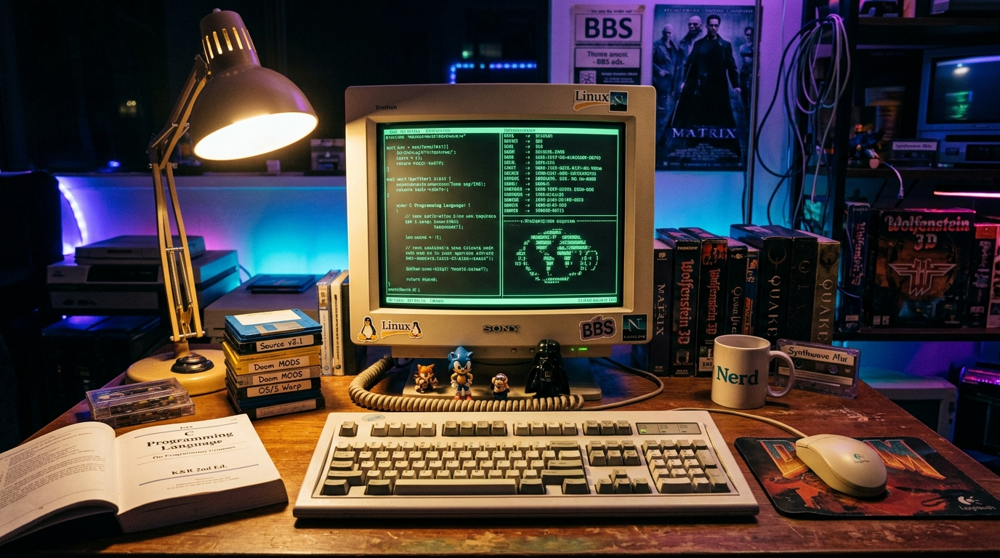

# 🕹️ Hi, I'm Viktor Kravets (Віктор Кравець)

  

  <em>Low-Level Systems Hacker • Kernel / Emulation Dev • Avid Retro Gamer</em> 
  📍 Kyiv, Ukraine 🇺🇦 • ⌨️ Model M Buckling Springs • 👾 CRT Shaders & Demoscene

---

### 💾 About Me

I'm a systems engineer obsessed with raw hardware performance, kernel primitives, and retro computer architecture. If it runs on silicon, I want to know how many CPU cycles it burns and why it isn't zero-copy.

Most of my waking hours are split between low-level C/C++/Rust pipelines and nostalgic gaming sessions:
- ⚡ **Systems & Performance**: Profiling cache misses, hand-optimizing SIMD instruction sets (`AVX-512`, `NEON`), tinkering with `io_uring` and Linux kernel drivers.
- 🕹️ **Retro Gaming Archivist**: Preserving classic PC-DOS, Amiga, and early 3D gaming history. Building custom CRT scanline shaders and contributing to cycle-accurate emulators (PCem, 86Box).
- ⌨️ **Hardware Nerd**: Typing exclusively on vintage IBM Model M buckling springs and building custom split mechanical keyboards.
- 🎧 **Soundtrack**: Heavy dark synthwave, industrial ambient, and classic video game MIDI soundfonts (Roland MT-32 / Sound Blaster AWE32).

---

### 🎮 Gaming Hall of Fame

| Era / Vibe | Favorites |
| :--- | :--- |
| **Ukrainian / Post-Soviet Classics** | *S.T.A.L.K.E.R.: Shadow of Chernobyl*, *S.T.A.L.K.E.R.: Call of Pripyat*, *Metro 2033* |
| **90s PC / Boomer Shooters** | *DOOM (1993)*, *DOOM II*, *Quake II*, *Quake III Arena*, *Blood*, *Deus Ex* |
| **Tactics & Strategy** | *Heroes of Might and Magic III (Horn of the Abyss)*, *Command & Conquer: Red Alert*, *Warcraft II* |
| **Modern Immersion** | *Cyberpunk 2077*, *Factorio* (the factory must grow), *Baldur's Gate 3*, *Elden Ring* |

---

### 🛠️ Tech Stack & Weapons of Choice

- **Low-Level & Runtimes**: C, C++20, Rust, x86-64 / ARM64 Assembly, Zig
- **Graphics & Emulation**: Vulkan, OpenGL, SDL2, cycle-accurate hardware emulation, shader development
- **Operating Systems**: Arch Linux (custom minimal kernel), FreeBSD, DOS 6.22
- **Tooling**: Neovim, `perf`, `gdb`, `rr` (record and replay debugger), `ghidra`
